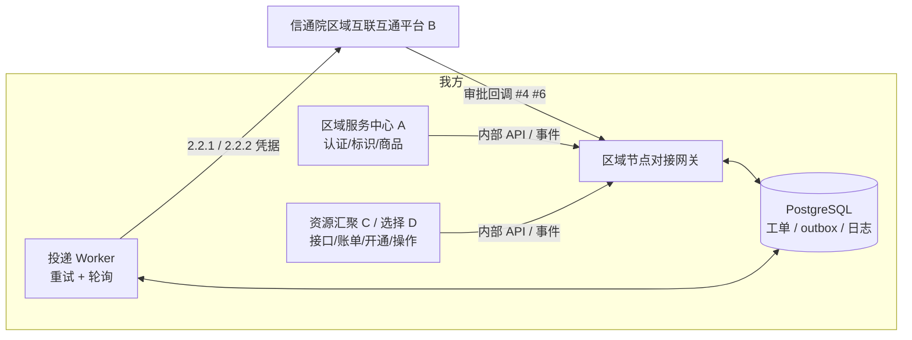
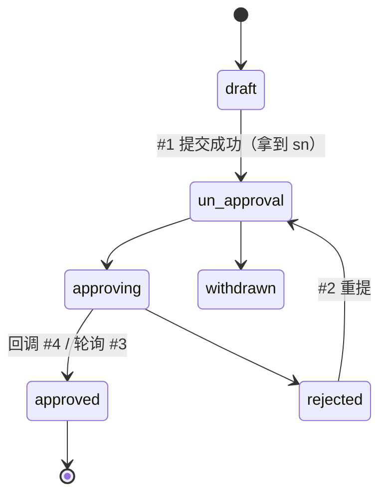
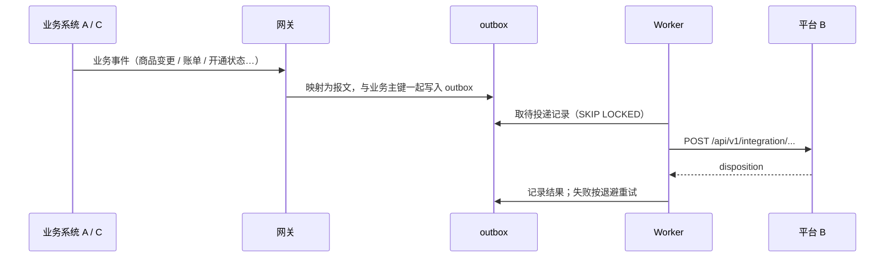

# 区域节点对接实施方案

**结论：建一个独立的"区域节点对接网关"服务，承接 11 个接口；申请类走"提交 + 回调 + 轮询兜底"，同步类走"本地 outbox + 至少一次投递 + disposition 仲裁"。按四个阶段推进，先打通实名认证与注册码，再上线五类数据同步。**

接口逐项分析见 [api-analysis.md](api-analysis.md)，待确认问题见 [open-questions.md](open-questions.md)。

## 1. 范围与前提

- 默认我方建设 **A（区域服务中心）+ C/D（资源汇聚 / 算力选择系统）**，B 为信通院区域互联互通平台。若我方只承担其一，按下表裁剪：只做 A 则保留 #1–#6、#8；只做 C/D 则保留 #7、#9–#11。
- 范围内：11 个接口、回调接收、凭据管理、枚举映射、重试补偿、对账、监控。
- 范围外：商品检索、规格检索（A 与 C/D 之间，不经过 B）；云商生命周期接口本身的对接（C 内部工作，#7 只同步结果）；算力标识上报（文档未给接口）。

## 2. 总体架构

网关对内提供统一的内部接口（或消费内部消息），对外是 B 的唯一出口和回调入口。业务系统不直接调 B，好处是凭据集中、格式校验集中、重试和审计集中。

## 3. 技术选型

| 项 | 选择 | 理由 |
| --- | --- | --- |
| 语言 / 框架 | Python 3.12 + FastAPI | 文档提供 Python 加密示例；适配层以 HTTP 和数据映射为主，开发快；Pydantic 直接做报文校验 |
| HTTP 客户端 | httpx | 支持超时、连接池、同步 / 异步 |
| 存储 | PostgreSQL 15+ | 工单、outbox、同步日志需事务一致；JSONB 存原始报文 |
| 任务调度 | outbox 表 + 独立 Worker 进程（`SELECT … FOR UPDATE SKIP LOCKED`） | 不引入 MQ 也能做到可靠投递；量大后可换 Kafka / RabbitMQ |
| 加密 | `cryptography`（AES-256-CBC） | 替代示例里的 pycryptodome；ak/sk、client_secret 落库加密 |
| 部署 | Docker + 现有 K8s / 主机 | 网关与 Worker 两个进程，Worker 可多副本 |
| 观测 | 结构化日志 + Prometheus 指标 | 推送成功率、stale 数、回调延迟、积压量 |

若团队主栈是 Go，可整体平移：gin + resty + pgx，加密直接用文档的 Go 示例。架构不变。

## 4. 模块划分

| 模块 | 职责 | 涉及接口 |
| --- | --- | --- |
| `core.client` | B 的 HTTP 客户端：注入 `X-CLIENT-ID/SECRET`，超时、日志脱敏、解析 `{data,result,code,message}`，区分 400 / 401 / 业务失败 / 网络错误 | 全部 |
| `core.credentials` | 两套凭据（2.2.1、2.2.2）和 ak/sk 的加密存储与轮换 | 全部 |
| `core.crypto` | 密码 AES 加密（已实现，见 `src/ixp_region_node/crypto.py`） | #1 #2 |
| `enums` | 城市、行业、资源类型、可用区、服务类型、单位性质、集团类型码表；`ecs/ebm` 与 6 位服务码的映射；入参校验 | #1 #2 #5 #7–#11 |
| `enterprise_auth` | 实名认证工单：提交、重提、查询、状态机、文件转 base64 | #1 #2 #3 |
| `ident_code` | 标识注册码工单：申请、状态机 | #5 |
| `callbacks` | 回调入口：鉴权校验、幂等落库、驱动工单状态、按约定格式应答 | #4 #6 |
| `sync` | 五类同步：内部事件 → 报文映射 → outbox → 投递 → 记录 disposition | #7–#11 |
| `reconcile` | 定时轮询未终态工单、补推失败记录、日对账报表 | #3，#7–#11 |
| `admin` | 运维接口：查工单、查推送记录、手工重推、手工触发查询 | — |

## 5. 关键设计

### 5.1 实名认证（#1–#4）

1. 业务侧提交资料 → 网关校验（枚举、必填、`id_num == uscc`）→ 文件转 base64 → 密码加密 → 调 #1，保存 `sn`。
2. `callback_url` 指向网关 `/callbacks/enterprise-auth`，URL 中带一次性随机 token 作为最低限度的来源校验。
3. 回调到达：按 `sn` 找工单，按 `(sn, status)` 幂等；`approved` 时写入 `provider_code` 并加密保存 `ak/sk`；返回 `{"result":true,"code":0,"message":"OK"}`。
4. 轮询兜底：未终态工单按退避间隔（如 5 分钟起，逐步放宽到 1 小时）调 #3，防止回调丢失或驳回不回调。
5. `rejected` 时把 `comment` 回给业务侧，修改后调 #2 重提。

### 5.2 标识注册码（#5–#6）

流程与实名认证一致，前置条件是已拿到 `provider_code`。由于没有查询接口，回调是唯一结果来源：回调接口必须高可用，同时记录"长时间无回调"的工单并告警，由人工向 B 查询。申请响应里已返回 `code`，先保存为"待审批注册码"，审批通过后转正。

### 5.3 数据同步（#7–#11）

- **业务主键**：直接用文档规定的 `capability_id`、`product_id`、`bill_id`、`activation_id`、`operation_id`；其中 uuid4 由 C 侧生成并持久化，重试时保持不变。
- **版本推进**：`updated_at` 取业务记录在 C 侧的真实更新时间，同一主键严格递增；同一主键的记录在 Worker 内串行投递，避免乱序引发 `stale`。
- **结果处理**：`created / duplicate / updated` 视为成功；`stale` 记为"被忽略"并告警；400 不重试，进人工队列；401 停止该凭据下所有投递并告警；5xx 和网络错误指数退避（1 分钟起，上限 1 小时，最多约 24 小时），超限进死信。
- **校验**：`source_id` 必须等于本次主键，不一致视为异常。
- **触发方式**：
  - #7 接口适配：C 每完成一个"提供商 × 服务 × 动作"的对接或健康状态变化时推送；另做每日全量重推，借 `duplicate` 保证一致。
  - #8 商品：A 商品新增 / 修改 / 上下架实时推送；下架发 `off_shelf`。`extra_params` 在入队前校验 ≤16 键、≤8KB。
  - #9 账单：账单生成即推；退订、退款以新 `bill_id` + 对应 `bill_type` 推送，不改原账单（待确认）。
  - #10 开通：受理时推 `status_code=1`，每个实例状态变化再推一次，全部终态推 2 或 3。
  - #11 操作：操作终态时推送一次。

### 5.4 数据映射

| 我方概念 | B 字段 | 说明 |
| --- | --- | --- |
| 云商名称 | `provider_name` | 统一用实名认证时登记的企业名，建码表避免"天翼云 / 天翼云科技有限公司"混用 |
| 调度方名称 | `dispatch_client_name` | 同上 |
| 服务类型 | `service_type` / `resource_type` | 同步类只用 `ecs`、`ebm`；与申请类 6 位码维护映射（如 ecs → 601001，ebm → 601003） |
| 地域 / 可用区 | `region_*` / `zone_*` | 用 C 系统对外 ID；与申请类城市码、可用区码另建映射 |
| 金额 | `amount` / `price` | 字符串，统一两位小数、单位元 |
| 时间 | `*_at` | 统一输出 `YYYY-MM-DDTHH:MM:SS.ffffff`，北京时间（时区待确认） |

### 5.5 安全

- client_secret、ak/sk 加密存储，日志和报文审计中脱敏；不写入代码仓库。
- 回调入口：URL token + B 出口 IP 白名单（需 B 提供）；仅暴露两个回调路径。
- 测试环境是 HTTP 明文，仅用测试凭据；生产要求 HTTPS（待确认）。
- 证件照片、授权书属于个人信息，落库加密，按最小留存期清理。

## 6. 分阶段实施计划

| 阶段 | 内容 | 完成标准 | 估算 |
| --- | --- | --- | --- |
| P0 准备 | 确认我方角色；拿到两套测试凭据；配置 hosts 打通测试环境；与 B 过一遍[待确认问题](open-questions.md) | 测试环境可连通，401 / 400 行为验证过；关键问题有书面答复 | 3–5 人日 |
| P1 基础 + 申请类 | 工程骨架、客户端、凭据、加密、码表；#1–#6；回调入口；轮询兜底；管理接口 | 测试环境走通"提交 → 审批 → 回调 → 拿到 provider_code / ak / sk → 申请注册码 → 回调拿到 code" | 10–15 人日 |
| P2 同步类 | outbox + Worker；#7–#11 映射与触发；disposition 处理；重试和死信 | 五类数据各自完成 created / duplicate / updated / stale 四种场景联调 | 10–15 人日 |
| P3 联调与加固 | 与 A、C 业务系统集成；全量初始化推送（存量商品、接口适配）；日对账；监控告警；压测 | 端到端用例全部通过；推送成功率、积压、stale 有看板和告警 | 5–10 人日 |
| P4 上线 | 生产凭据与地址；灰度（先 #7 #8，再 #9–#11）；存量补推 | 生产首日对账一致 | 3–5 人日 |

估算按 1–2 名后端开发，未含等待 B 方答复和审批的时间。

## 7. 测试要点

- 加密：用同一 key 加解密往返；与 B 联调确认能解开（IV 前置格式）。
- 申请类：必填缺失 → 400；错误凭据 → 401；驳回 → 重提；回调重复到达、乱序到达（先 approved 后 approving）。
- 同步类：同报文重推 → `duplicate`；更新 → `updated`；旧 `updated_at` → `stale`；`instances` 多实例部分失败；`extra_params` 超限。
- 可靠性：B 不可用 1 小时后恢复，积压自动清空且无重复数据。

## 8. 风险

| 风险 | 影响 | 应对 |
| --- | --- | --- |
| 文档字段与示例多处不一致（见分析第 7 节） | 联调反复返工 | P0 集中确认，以 B 实际校验为准，网关映射层集中改 |
| 注册码无查询接口，回调丢失即丢结果 | 工单卡住 | 回调高可用 + 无回调告警 + 人工查询通道 |
| 驳回可能不回调 | 用户不知道被驳回 | 轮询 #3 兜底 |
| 商品无更新时间字段 | 乱序时可能被旧数据覆盖 | 同一 `product_id` 串行投递；向 B 确认判定规则 |
| 回调无鉴权 | 伪造回调篡改工单状态 | URL token + IP 白名单；approved 回调后再调 #3 复核 |
| 测试环境 HTTP 明文 | 凭据泄露 | 测试凭据隔离；生产强制 HTTPS |
| 配置变更、算力标识上报无接口 | 业务覆盖不全 | 列入待确认，预留扩展点 |
| 生产地址、限流、报文大小上限未知 | 上线前才暴露问题 | P0 索取；Worker 预设限速 |
